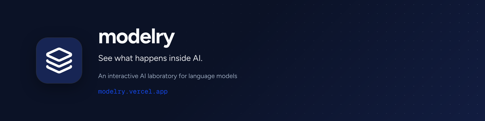

<p align="center"></p>

<h1 align="center">Modelry</h1>

<p align="center"><strong>See what happens inside AI.</strong></p>

<p align="center">
  <a href="https://modelry.vercel.app">Live app: modelry.vercel.app</a>
</p>

Modelry is an interactive AI laboratory where developers experiment with language models, understand their behavior, and learn how AI-powered software actually works.

## Try it

Open [modelry.vercel.app](https://modelry.vercel.app), create an account (email/password or GitHub), and go to `/chat`. New accounts get starter credits once (default `STARTER_CREDITS=50000`).

## Features

- **Streaming AI chat**: an authenticated, thread-aware `/api/ai/chat` route built on the Vercel AI SDK, with Ollama for local models and Google Gemini support.
- **Threads and history**: create, rename, delete and revisit chat threads (`/chat`, `/chat/[threadId]`).
- **Credits system**: a wallet plus ledger, starter credits granted once, credit reservation before each model call and settlement after it.
- **Auth**: Better Auth with email/password, GitHub OAuth and email verification through Resend.
- **Attachments**: file uploads to Vercel Blob, with size and count limits you can configure.
- **Billing scaffolding**: subscription plans, subscriptions and payment events (Razorpay).
- **Usage analytics**: chat lifecycle events and usage summaries.
- **Security**: Arcjet protection on the chat, upload and tRPC mutation routes.
- **Studio and account**: `/studio` workspace for staff and admins, `/account` for profile and security.

## Tech stack

| Area | Tools |
| --- | --- |
| Framework | Next.js 16 (App Router), React 19, TypeScript |
| API | tRPC 11, TanStack Query, superjson, Zod |
| AI | Vercel AI SDK (`ai`, `@ai-sdk/react`, `@ai-sdk/google`), `ollama-ai-provider-v2`, Streamdown, Shiki |
| Auth | Better Auth |
| Database | Neon Postgres, Drizzle ORM, drizzle-kit |
| UI | Tailwind CSS 4, shadcn/ui, Radix UI, lucide-react, Motion, GSAP, Recharts |
| Email | Resend, React Email |
| Storage | Vercel Blob |
| Security | Arcjet |
| Tooling | pnpm, Biome, Husky, `@t3-oss/env-nextjs` |

## Getting started

### Prerequisites

- Node.js 20+
- pnpm
- A Postgres database (for example [Neon](https://neon.tech))
- [Ollama](https://ollama.com) if you want to run models locally

### Setup

```bash
git clone https://github.com/jayantrohila57/modelry.git
cd modelry
pnpm install
cp .env.example .env.local   # then fill in the values
ollama pull qwen3.5:0.8b     # default local model
pnpm db:migrate              # or: pnpm db:push
pnpm dev
```

Open http://localhost:3000, sign in, and go to `/chat`.

## Environment variables

Copy `.env.example` to `.env.local`. The variables are validated in `src/shared/config/env.server.ts` and `src/shared/config/env.client.ts`.

| Group | Variables |
| --- | --- |
| Auth | `BETTER_AUTH_SECRET`, `BETTER_AUTH_URL` |
| App URLs | `NEXT_PUBLIC_BASE_URL`, `NEXT_PUBLIC_API_URL` |
| Database | `DATABASE_URL` |
| Email | `RESEND_API_KEY`, `RESEND_FROM_EMAIL` |
| OAuth | `GITHUB_CLIENT_ID`, `GITHUB_CLIENT_SECRET` |
| AI | `AI_PROVIDER`, `OLLAMA_BASE_URL`, `OLLAMA_MODEL` |
| Optional | `ARKJET_API_KEY`, `BLOB_READ_WRITE_TOKEN`, `RAZORPAY_KEY_ID`, `RAZORPAY_KEY_SECRET`, `RAZORPAY_WEBHOOK_SECRET`, `NEXT_PUBLIC_RAZORPAY_KEY_ID` |

### AI provider

`AI_PROVIDER` picks the model backend in `src/module/ai/ai.provider.ts`. Only two values are supported; anything else throws `Unsupported AI provider`.

- `ollama` (default): uses `OLLAMA_BASE_URL` (default `http://127.0.0.1:11434/api`) and `OLLAMA_MODEL` (default `qwen3.5:0.8b`).
- `google`: uses `@ai-sdk/google`. That SDK reads its key from `GOOGLE_GENERATIVE_AI_API_KEY`, which is not listed in `.env.example`.

### Credits

Defaults come from `src/shared/config/env.server.ts`: `STARTER_CREDITS=50000` granted once per user, `CHAT_RESERVE_MIN_CREDITS=256` and `CHAT_RESERVE_RATIO=2` for the reservation made before each model call, and `SUBSCRIPTION_MONTHLY_CREDITS=250000`. Razorpay plans use `RAZORPAY_STARTER_PLAN_ID` and `RAZORPAY_PRO_PLAN_ID`.

Optional limits (they have defaults): `STARTER_CREDITS`, `CHAT_RESERVE_MIN_CREDITS`, `CHAT_RESERVE_RATIO`, `SUBSCRIPTION_MONTHLY_CREDITS`, `MAX_UPLOAD_FILE_SIZE_BYTES`, `MAX_UPLOAD_FILES_PER_MESSAGE`.

## Scripts

| Script | What it does |
| --- | --- |
| `pnpm dev` | Clear `.next` and start the dev server |
| `pnpm build` / `pnpm start` | Production build and serve |
| `pnpm typecheck` | `tsc --noEmit` |
| `pnpm lint` / `pnpm lint:fix` | Biome lint |
| `pnpm format` / `pnpm format:check` | Biome format |
| `pnpm check` | Biome check plus typecheck |
| `pnpm db:generate` / `db:migrate` / `db:push` / `db:studio` | Drizzle migrations and studio |
| `pnpm db:introspect` / `db:drop` / `db:reset` | Drizzle maintenance |
| `pnpm auth:generate` / `auth:migrate` | Better Auth schema |
| `pnpm email:dev` | React Email preview |
| `pnpm starter:smoke` | Starter-credits smoke test |

## Project structure

```
.
├── migrations/          # Drizzle SQL migrations
├── public/              # Static assets (logo.png, icon.svg)
├── scripts/             # Smoke tests
└── src/
    ├── app/             # Next.js routes: (site) pages, api/, layout, manifest
    ├── core/            # api (tRPC), auth, db, mail, query, theme
    ├── module/          # Features: account, ai, analytics, attachments, auth,
    │                    #   billing, chat, credits, system, viewer
    └── shared/          # components, config (env), schema, styles, types, utils
```

## Brand


**See what happens inside AI.**

Brand assets live in [`.github/brand`](.github/brand): logo mark (SVG and PNG), wordmark (SVG), light and dark lockups, app icons (512, 192 and 32 px), an Open Graph image (1200×630), a GitHub social preview (1280×640), this README banner, an X/LinkedIn banner (1500×500) and a palette sheet.

| Role | Hex | Source |
| --- | --- | --- |
| Brand navy (mark, theme-color) | `#172554` | `siteConfig.brand.navy` |
| Primary (light) | `#1447e6` | `--primary` |
| Primary (dark) | `#193cb8` | `--primary (dark)` |
| Primary foreground | `#eff6ff` | `--primary-foreground` |
| Email primary | `#152238` | `siteConfig.colors.primary` |

Type: Figtree (from `src/shared/utils/methods/font.ts`). The wordmark is lowercase `modelry`.

## License

[MIT](LICENSE) © 2026 Jayant Rohila

## Sponsor

If you find this project useful, consider supporting its development:

[](https://github.com/sponsors/jayantrohila57)
